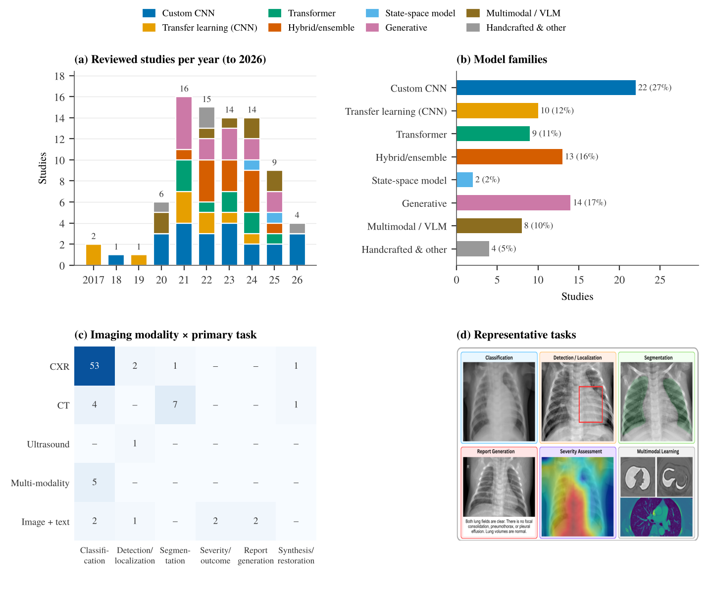

# Why Deep Vision Models for Pneumonia Imaging Do Not Generalize

Companion repository for the review **"Why Deep Vision Models for Pneumonia Imaging Do Not Generalize: A Critical Review from CNNs to Vision–Language Foundation Models"** (submitted to *Image and Vision Computing*).

It contains:

- **`catalog/catalog.csv`** — the catalogue of the 82 pneumonia imaging studies discussed in the review (Table S1 of the supplement), with year, modality, task, model family, learning paradigm, training/test data, data availability, link to the original paper, official code link and the sources used to verify them.
- **`refs.bib`** — the bibliography of the review.
- **`scripts/`** — scripts that regenerate the chord diagram (Fig. 3), the literature-landscape figure (Fig. 4) and the study tables from the CSV.
- **`search/`** — the database search strings (also given in Table S2 of the supplementary material).

> **Scope.** This is a *critical narrative review*: studies were selected purposively (relevance, influence, methodological coverage, recency), not by a PRISMA systematic protocol. Counts describe the reviewed studies, not the whole literature. Contributions and corrections are welcome (see below).

## Key findings

- **No external tests.** In eight frequently cited classification studies reporting 93–99% accuracy, none evaluated on an external dataset and none reported a patient-level split.
- **Leakage and shortcuts.** Augmented or enhanced copies created before splitting, 16-image validation sets, and composite datasets in which the data source predicts the label are common. Where external testing exists, performance drops (e.g. AUC 93.1% → 81.5% at a new hospital system).
- **Architectures raise benchmark scores, not demonstrated robustness.** Transformers, hybrids and state-space models have not been compared under matched external testing.
- **Reproducibility.** Only 10 of 82 catalogued studies (12%) link an official code repository.
- **Most promising route:** large-scale self-supervised and vision–language pretraining — still lacking pneumonia-specific external evaluation.

## Catalogue

Legend — **Paper:** link to the published version (DOI where available, otherwise the arXiv page). **Code:** `code` = official repository; `—` = none found in the paper or by repository search; `NR` = could not be determined. **Data:** NR = not reported or not determinable from accessible sources. Full dataset descriptions and verification sources are in `catalog/catalog.csv`.

### Handcrafted and radiomic features

| Year | Study | Modality | Task | Data | Key idea | Paper | Code |
|---|---|---|---|---|---|---|---|
| 2020 | **Liu** — Differentiating novel coronavirus pneumonia from general pneumonia based on machine learning | CT | Classification | Single-centre CT, Ruian People's Hospital (61 COVID-19 + 27 general pneumonia patients; data link given via Baidu Pan) | GLCM, GLGCM and histogram texture features with ReliefF selection | [paper](https://doi.org/10.1186/s12938-020-00809-9) | — |
| 2022 | **Al-Areqi** — Effectiveness evaluation of different feature extraction methods for classification of covid-19 from computed tomography images: A high accuracy classification study | CT | Classification | COVID-CT (UCSD-AI4H, 746 CT images) | Comparison of texture descriptors (GLRLM, GLSZM, GLDM, NGTDM) for COVID-19 CT | [paper](https://doi.org/10.1016/j.bspc.2022.103662) | — |
| 2022 | **Ortiz-Toro** — Automatic detection of pneumonia in chest X-ray images using textural features | CXR | Classification | Kermany pediatric CXR (GWCMC); Cohen COVID-19 image collection + NIH ChestX-ray8 ("Josep-NIH") | Radiomic, fractal and superpixel texture features with classical classifiers | [paper](https://doi.org/10.1016/j.compbiomed.2022.105466) | — |

### Custom CNNs

| Year | Study | Modality | Task | Data | Key idea | Paper | Code |
|---|---|---|---|---|---|---|---|
| 2020 | **Polsinelli** — A light CNN for detecting COVID-19 from CT scans of the chest | CT | Classification | COVID-CT (Zhao et al.); SIRM COVID-19 CT cases | Lightweight SqueezeNet-based CNN for COVID-19 CT | [paper](https://doi.org/10.1016/j.patrec.2020.10.001) | — |
| 2021 | **CoroDet** — CoroDet: A deep learning based classification for COVID-19 detection using chest X-ray images | CXR, CT | Classification | NR | 22-layer CNN (CoroDet) on pooled public images | [paper](https://doi.org/10.1016/j.chaos.2020.110495) | NR |
| 2022 | **COVID-WideNet** — COVID-WideNet—A capsule network for COVID-19 detection | CXR | Classification | COVIDx (CXR) | Capsule network with dynamic routing (COVID-WideNet) | [paper](https://doi.org/10.1016/j.asoc.2022.108780) | [code](https://github.com/Harsh9524/COVID-WideNet) |
| 2022 | **Szepesi** — Detection of pneumonia using convolutional neural networks and deep learning | CXR | Classification | NR | Custom CNN with dropout inside convolutional layers | [paper](https://doi.org/10.1016/j.bbe.2022.08.001) | NR |
| 2023 | **CDC\_Net** — CDC\_Net: Multi-classification convolutional neural network model for detection of COVID-19, pneumothorax, pneumonia, lung Cancer, and tuberculosis using chest X-rays | CXR | Classification | Multi-source public CXR: Cohen COVID-19 collection, SIRM, TCIA, Radiopaedia, Mendeley, NIH ChestX-ray, Kaggle pneumothorax (SIIM), Kermany/RSNA pneumonia, JSRT (Shiraishi) lung nodules, Kaggle TB database | Residual and dilated convolutions for six-class chest disease classification | [paper](https://doi.org/10.1007/s11042-022-13843-7) | — |
| 2023 | **Yi** — Identification and classification of pneumonia disease using a deep learning-based intelligent computational framework | CXR | Classification | NR | Deep custom CNN with CLAHE preprocessing and augmentation | [paper](https://doi.org/10.1007/s00521-021-06102-7) | — |
| 2026 | **AXNet** — AXNet: Attention-enhanced X-ray network for pneumonia detection | CXR | Classification | NR | ResNet-18 with CBAM and efficient channel attention | [paper](https://doi.org/10.1016/j.bspc.2026.109618) | NR |
| 2026 | **QSCNN** — A quantum-inspired medical scalable convolutional neural network for Intelligent pneumonia diagnosis | CXR | Classification | NR | Quantum-inspired scalable CNN | [paper](https://doi.org/10.1016/j.bspc.2025.108440) | NR |

### Transfer learning

| Year | Study | Modality | Task | Data | Key idea | Paper | Code |
|---|---|---|---|---|---|---|---|
| 2017 | **CheXNet** — Chexnet: Radiologist-level pneumonia detection on chest x-rays with deep learning | CXR | Classification | ChestX-ray14 (NIH); 420-image Stanford radiologist-annotated test set | DenseNet-121 fine-tuned on ChestX-ray14; compared with radiologists | [paper](https://arxiv.org/abs/1711.05225) | — |
| 2019 | **Varshni** — Pneumonia detection using CNN based feature extraction | CXR | Classification | ChestX-ray14 (NIH; balanced subset 1,431 pneumonia + 1,431 no finding) | Pretrained CNN features (DenseNet-169) with SVM classifier | [paper](https://doi.org/10.1109/icecct.2019.8869364) | — |
| 2021 | **Ikechukwu** — ResNet-50 vs VGG-19 vs training from scratch: A comparative analysis of the segmentation and classification of Pneumonia from chest X-ray images | CXR | Classification | NR | VGG-19 and ResNet-50 transfer learning vs training from scratch | [paper](https://doi.org/10.1016/j.gltp.2021.08.027) | NR |
| 2021 | **Ismael** — Deep learning approaches for COVID-19 detection based on chest X-ray images | CXR | Classification | 380 CXR (180 COVID-19, 200 normal) from Cohen GitHub collection, Kaggle and Radiology Assistant | Deep features and fine-tuned CNNs for COVID-19 CXR | [paper](https://doi.org/10.1016/j.eswa.2020.114054) | — |
| 2021 | **CovidXrayNet** — CovidXrayNet: Optimizing data augmentation and CNN hyperparameters for improved COVID-19 detection from CXR | CXR | Classification | COVIDx (v3); COVIDcxr (built from ChestX-ray14 + Cohen COVID-19 collection) | EfficientNet-B0 with tuned augmentation (CovidXrayNet) | [paper](https://doi.org/10.1016/j.compbiomed.2021.104375) | [code](https://github.com/MaramMonshi/CovidXrayNet) |
| 2022 | **Yang** — A deep learning approach considering image background for pneumonia identification using explainable AI (XAI) | CXR | Classification | Kermany pediatric CXR (Guangzhou Women and Children's Medical Center), with backgrounds removed | Background removal (lung and heart only) with Grad-CAM inspection | [paper](https://doi.org/10.1109/tcbb.2022.3190265) | — |
| 2023 | **Sharma** — A deep learning based model for the detection of pneumonia from chest X-ray images using VGG-16 and neural networks | CXR | Classification | Kermany pediatric CXR (Kaggle paultimothymooney); Kaggle chest-xray-covid19-pneumonia (prashant268) | VGG-16 features with several downstream classifiers | [paper](https://doi.org/10.1016/j.procs.2023.01.018) | — |
| 2024 | **Ibrahim** — Pneumonia classification using deep learning from chest X-ray images during COVID-19 | CXR | Classification | Cohen covid-chestxray-dataset; COVID-19 Radiography Database (Kaggle); Kaggle novel-corona-virus-2019 dataset; Kermany pediatric CXR | AlexNet transfer learning for COVID-19, bacterial and viral pneumonia | [paper](https://doi.org/10.1007/s12559-020-09787-5) | — |

### Vision Transformers

| Year | Study | Modality | Task | Data | Key idea | Paper | Code |
|---|---|---|---|---|---|---|---|
| 2021 | **Krishnan** — Vision transformer based COVID-19 detection using chest X-rays | CXR | Classification | COVID-19 Radiography Database (Chowdhury/Rahman); Kaggle COVID19 Pneumonia Normal Chest X-ray PA dataset (test) | ViT-B/32 with frozen lower layers | [paper](https://doi.org/10.1109/ispcc53510.2021.9609375) | — |
| 2021 | **xViTCOS** — xViTCOS: explainable vision transformer based COVID-19 screening using radiography | CXR, CT | Classification | COVIDx CT-2A (CT); CXR set from Kaggle Chest X-Ray Images (Pneumonia) [Kermany] + COVIDx CXR-2; CheXpert for intermediate fine-tuning | Multi-stage transfer of ViT via CheXpert (xViTCOS) | [paper](https://doi.org/10.1109/jtehm.2021.3134096) | [code](https://github.com/arnabkmondal/xViTCOS) |
| 2021 | **COVID-Transformer** — Covid-transformer: Interpretable covid-19 detection using vision transformer for healthcare | CXR | Classification | El-Shafai et al. COVID-19 X-ray/CT (Mendeley); Sait et al. curated COVID-19 PA CXR (Mendeley); COVID-Ti (Qi et al.) - merged 30K balanced set | ViT-L/16 for COVID-19 classification | [paper](https://doi.org/10.3390/ijerph182111086) | [code](https://github.com/DebadityaShome/COVID-Transformer) |
| 2022 | **Park** — Multi-task vision transformer using low-level chest X-ray feature corpus for COVID-19 diagnosis and severity quantification | CXR | Classification, severity | CheXpert (backbone pretraining); BIMCV, Brixia, NIH ChestX-ray, PadChest, CheXpert (public); private Korean hospitals AMC, CNUH, YNU, KNUH (training/external test) | Multi-task ViT on a backbone pretrained on CXR findings; severity maps | [paper](https://doi.org/10.1016/j.media.2021.102299) | NR |
| 2023 | **Khaniki** — Enhancing pneumonia detection using vision transformer with dynamic mapping re-attention mechanism | CXR | Classification | NR | ViT with dynamic mapping re-attention | [paper](https://doi.org/10.1109/iccke60553.2023.10326313) | NR |
| 2024 | **Singh** — Efficient pneumonia detection using Vision Transformers on chest X-rays | CXR | Classification | Kermany pediatric CXR (Mendeley rscbjbr9sj/2, Guangzhou Women and Children's Medical Center) | Standard ViT on pediatric radiographs | [paper](https://doi.org/10.1038/s41598-024-52703-2) | — |
| 2025 | **MSDA-Former** — A mixed-scale dynamic attention transformer for pediatric pneumonia diagnosis | CXR | Classification | NR | Mixed-scale dynamic attention Transformer with language-model guidance | [paper](https://doi.org/10.1016/j.displa.2024.102953) | NR |

### Hybrid architectures and ensembles

| Year | Study | Modality | Task | Data | Key idea | Paper | Code |
|---|---|---|---|---|---|---|---|
| 2021 | **CNN--PCA--ELM** — A novel method for multivariant pneumonia classification based on hybrid CNN-PCA based feature extraction using extreme learning machine with CXR images | CXR | Classification | Kermany pediatric CXR (Kaggle; normal/bacterial/viral, 5,857 images) | CNN features reduced by PCA and classified with an ELM | [paper](https://doi.org/10.1109/access.2021.3123782) | — |
| 2022 | **Fan** — COVID-19 CT image recognition algorithm based on transformer and CNN | CT | Classification | COVIDx-CT (194,922 images, 3,745 patients; CNCB-derived) | Parallel CNN and Transformer branches with bidirectional fusion | [paper](https://doi.org/10.1016/j.displa.2022.102150) | — |
| 2022 | **Mabrouk** — Pneumonia detection on chest X-ray images using ensemble of deep convolutional neural networks | CXR | Classification | Kermany pediatric CXR (Kaggle paultimothymooney, 5,856 images) | Ensemble of DenseNet-169, MobileNetV2 and ViT | [paper](https://doi.org/10.3390/app12136448) | — |
| 2022 | **Mujahid** — Pneumonia classification from X-ray images with inception-V3 and convolutional neural network | CXR | Classification | Kermany pediatric CXR (Kaggle paultimothymooney) | Ensemble of Inception-V3, VGG-16, ResNet-50 and a custom CNN | [paper](https://doi.org/10.3390/diagnostics12051280) | — |
| 2022 | **Ukwuoma'22** — Automated lung-related pneumonia and COVID-19 detection based on novel feature extraction framework and vision transformer approaches using chest X-ray images | CXR | Classification | COVID-19 Radiography Database (Kaggle); ChestX-ray-15k (Badawi et al.) | Fused multi-CNN features with higher-order pooling and ViT | [paper](https://doi.org/10.3390/bioengineering9110709) | — |
| 2023 | **Reddy** — Multi-modal fusion of deep transfer learning based COVID-19 diagnosis and classification using chest x-ray images | CXR | Classification | NR | Fusion of VGG-16, Inception-V3 and ResNet-50 | [paper](https://doi.org/10.1007/s11042-022-13739-6) | NR |
| 2023 | **Ukwuoma'23** — A hybrid explainable ensemble transformer encoder for pneumonia identification from chest X-ray images | CXR | Classification | NR | Six-backbone CNN ensemble with Transformer encoder | [paper](https://doi.org/10.1016/j.jare.2022.08.021) | [code](https://github.com/chiagoziemchima/Pneumonia_Identificaton) |
| 2023 | **PneuNet** — PneuNet: deep learning for COVID-19 pneumonia diagnosis on chest X-ray image analysis using Vision Transformer | CXR | Classification | NR | ResNet-18 features processed by a ViT encoder | [paper](https://doi.org/10.1007/s11517-022-02746-2) | NR |
| 2024 | **Angara** — A novel method to enhance pneumonia detection via a model-level ensembling of CNN and vision transformer | CXR | Classification | Kermany pediatric CXR (Kaggle) | Model-level ensemble of CNN and ViT | [paper](https://arxiv.org/abs/2401.02358) | — |
| 2024 | **CCNN** — Concatenated CNN-based pneumonia detection using a fuzzy-enhanced dataset | CXR | Classification | Kermany pediatric CXR (Kaggle, 5,856 images) + fuzzy-enhanced derived versions | Concatenated CNN over fuzzy-enhanced image copies | [paper](https://doi.org/10.3390/s24206750) | — |
| 2024 | **Elangovan** — Covid-19net: An effective and robust approach for covid-19 detection using ensemble of convnet-24 and customized pre-trained models | CXR | Classification | NR | Ensemble of ConvNet-24 and pretrained CNNs | [paper](https://doi.org/10.1007/s00034-023-02564-3) | NR |
| 2024 | **XCCNet** — An explainable contrastive-based dilated convolutional network with transformer for pediatric pneumonia detection | CXR | Classification | Kermany; VinDr-PCXR; NIH-Pediatric; Trivedi dataset | Contrastively aligned dilated-CNN and Transformer branches (XCCNet) | [paper](https://doi.org/10.1016/j.asoc.2024.112258) | — |
| 2025 | **Saber** — Efficient and accurate pneumonia detection using a novel multi-scale transformer approach | CXR | Classification, segmentation | Chest X-ray Masks and Labels (lung segmentation); Kermany; Cohen COVID-19 image collection | Multi-scale Transformer with TransUNet-style lung segmentation | [paper](https://doi.org/10.3390/s25237233) | [code](https://github.com/amirrezafateh/Multi-Scale-Transformer-Pneumonia) |

### State-space models and other paradigms

| Year | Study | Modality | Task | Data | Key idea | Paper | Code |
|---|---|---|---|---|---|---|---|
| 2024 | **MedMamba** — Medmamba: Vision mamba for medical image classification | CXR | Classification | 16 datasets incl. CPN X-ray (COVID/Pneumonia/Normal), PneumoniaMNIST and other MedMNIST sets, PAD-UFES-20, Kvasir, Fetal-Planes-DB, Otoscopy2024, Cervical-US | Hybrid convolution and selective state-space blocks (MedMamba) | [paper](https://arxiv.org/abs/2403.03849) | [code](https://github.com/YubiaoYue/MedMamba) |
| 2025 | **Mamba-YOLOvX** — Localization and classification of abnormalities on chest X-ray images using a Mamba-YOLOvX model | CXR | Detection | VinDr-CXR; ChestX-ray8; CXR-AL14 | Mamba blocks inside a YOLO detector for CXR abnormalities | [paper](https://doi.org/10.1016/j.eswa.2025.127929) | — |
| 2026 | **MDA-SNN** — Optimized multi-dimensional attention spiking neural network for pneumonia detection in chest x-ray images | CXR | Classification | NR | Multi-dimensional attention spiking neural network | [paper](https://doi.org/10.1016/j.bspc.2025.108765) | NR |

### Weakly supervised learning

| Year | Study | Modality | Task | Data | Key idea | Paper | Code |
|---|---|---|---|---|---|---|---|
| 2017 | **ChestX-ray8** — Chestx-ray8: Hospital-scale chest x-ray database and benchmarks on weakly-supervised classification and localization of common thorax diseases | CXR | Classification, localization | ChestX-ray8 (NIH Clinical Center; later ChestX-ray14) | Weakly supervised classification and localization on text-mined labels | [paper](https://doi.org/10.1109/cvpr.2017.369) | — |
| 2018 | **Yan** — Weakly supervised deep learning for thoracic disease classification and localization on chest x-rays | CXR | Classification, localization | ChestX-ray14 | Attention and multi-map transfer for weak localization | [paper](https://doi.org/10.1145/3233547.3233573) | — |
| 2020 | **LITERATI** — Weakly supervised one-stage vision and language disease detection using large scale pneumonia and pneumothorax studies | CXR + text | Detection | MIMIC-CXR (with reports; new radiologist box annotations); NIH ChestX-ray14 | One-stage vision--language detection with scene-level labels (LITERATI) | [paper](https://doi.org/10.1007/978-3-030-59719-1_5) | — |
| 2021 | **Keshavamurthy** — Weakly supervised pneumonia localization in chest X-rays using generative adversarial networks | CXR | Localization | RSNA Pneumonia Detection Challenge (14,184 CXRs for validation); unpaired normal/abnormal CXR training set (unnamed in abstract) | GAN pseudo-normal reconstruction for opacity localization | [paper](https://doi.org/10.1002/mp.15185) | NR |
| 2023 | **Ouyang (LUS)** — Weakly semi-supervised detection in lung ultrasound videos | US (video) | Detection | Private retrospective multi-center LUS dataset (7,998 videos, 420 patients, 8 U.S. clinical sites, lung consolidation) | Teacher--student weakly semi-supervised detection in LUS video | [paper](https://doi.org/10.1007/978-3-031-34048-2_16) | — |

### Self- and semi-supervised learning

| Year | Study | Modality | Task | Data | Key idea | Paper | Code |
|---|---|---|---|---|---|---|---|
| 2021 | **Han** — Pneumonia detection on chest x-ray using radiomic features and contrastive learning | CXR | Classification | RSNA Pneumonia Detection Challenge (CIFAR-10 for backbone pretraining) | Contrastive learning combined with radiomic features | [paper](https://doi.org/10.1109/isbi48211.2021.9433853) | — |
| 2021 | **Hao** — Self-supervised pretraining for covid-19 and other pneumonia detection from chest x-ray images | CXR | Classification | NR | Location-sensitive self-supervised pretext task | [paper](https://doi.org/10.1007/978-3-030-89698-0_102) | NR |
| 2021 | **Inception-GAN** — Inception-GAN for Semi-supervised Detection of Pneumonia in Chest X-rays | CXR | Classification | NR | Inception-GAN for semi-supervised anomaly detection | [paper](https://doi.org/10.1109/embc46164.2021.9630473) | NR |
| 2022 | **Wei** — Deep pneumonia: Attention-based contrastive learning for class-imbalanced pneumonia lesion recognition in chest x-rays | CXR | Classification | Yanxishe (god.yanxishe.com) pneumonia CXR dataset, 20,012 images, 5 classes (normal + 4 pneumonia types) | Attention-based contrastive learning under class imbalance | [paper](https://doi.org/10.1109/bigdata55660.2022.10020283) | — |
| 2023 | **Shakouri (DINO)** — DINO-CXR: A self supervised method based on vision transformer for chest X-ray classification | CXR | Classification | Kaggle 'ChestX-ray14-v3' (unlabeled pretraining); Kermany pediatric CXR (Cell); COVIDGR | DINO self-distillation on chest radiographs | [paper](https://doi.org/10.1007/978-3-031-47966-3_25) | — |
| 2024 | **SPCXR** — SS-CXR: self-supervised pretraining using chest x-rays towards a domain specific foundation model | CXR | Classification | COVIDx CXR-3 sources (BIMCV, Stony Brook, RSNA Pneumonia, RSNA-RICORD, SIRM, FIG-1, Cohen, ActMed); in-house pediatric CXR (189 images); Shenzhen/Belarus/Montgomery for segmentation | Domain-specific self-supervised pretraining on CXR | [paper](https://doi.org/10.1109/icip51287.2024.10647378) | — |
| 2024 | **Zang** — Pneumonia infection segmentation using semi-supervised learning and uncertainty estimation | CT | Segmentation | MosMedData (COVID-19 chest CT) | Uncertainty-guided semi-supervised infection segmentation | [paper](https://doi.org/10.1109/eit63098.2024.10762624) | NR |

### Unsupervised, domain adaptation and federated learning

| Year | Study | Modality | Task | Data | Key idea | Paper | Code |
|---|---|---|---|---|---|---|---|
| 2022 | **Qayyum** — Collaborative federated learning for healthcare: Multi-modal covid-19 diagnosis at the edge | CXR, US | Classification | COVID-19 Image Data Collection (Cohen et al., CXR); POCUS lung ultrasound dataset (Born et al.) | Clustered federated learning across X-ray and ultrasound | [paper](https://doi.org/10.1109/ojcs.2022.3206407) | — |
| 2023 | **Feng** — Contrastive domain adaptation with consistency match for automated pneumonia diagnosis | CXR | Classification | RSNA Pneumonia (Stage I) -> Kermany pediatric CXR; RSNA+COVID (1,858 COVID cases) -> TTSH (Tan Tock Seng Hospital, private) | Contrastive domain adaptation with consistency matching | [paper](https://doi.org/10.1016/j.media.2022.102664) | — |

### Generative models (GAN/VAE)

| Year | Study | Modality | Task | Data | Key idea | Paper | Code |
|---|---|---|---|---|---|---|---|
| 2021 | **IAGAN** — Data augmentation using Generative Adversarial Networks (GANs) for GAN-based detection of Pneumonia and COVID-19 in chest X-ray images | CXR | Classification | Kermany pediatric CXR; COVIDx (incl. Cohen covid-chestxray); Montgomery (segmentation pretraining) | IAGAN augmentation conditioned on real images | [paper](https://doi.org/10.1016/j.imu.2021.100779) | — |
| 2021 | **Srivastav** — Improved classification for pneumonia detection using transfer learning with GAN based synthetic image augmentation | CXR | Classification | NR | DCGAN augmentation with VGG-16 | [paper](https://doi.org/10.1109/confluence51648.2021.9377062) | NR |
| 2021 | **Lung-GANs** — Lung-GANs: unsupervised representation learning for lung disease classification using chest CT and X-ray images | CXR, CT | Classification | Six public lung disease datasets (CXR and CT; COVID-19, pediatric pneumonia, TB) - not individually named in abstract | GAN-based unsupervised representation learning (Lung-GANs) | [paper](https://doi.org/10.1109/tem.2021.3103334) | [code](https://github.com/yadavpa1/Lung-GAN) |
| 2022 | **Khalifa** — Detection of coronavirus (COVID-19) associated pneumonia based on generative adversarial networks and a fine-tuned deep transfer learning model using chest X-ray dataset | CXR | Classification | Kermany pediatric CXR (Mendeley, 624-image subset); despite COVID title, no COVID data | Lightweight GAN augmentation with transfer learning | [paper](https://doi.org/10.1007/978-3-031-20601-6_22) | — |
| 2022 | **TESRGAN** — Super-resolution reconstruction of pneumocystis carinii pneumonia images based on generative confrontation network | CT | Super-resolution | PCP CT images (source not stated in abstract); Set5 benchmark for SR evaluation | Texture-enhanced super-resolution GAN for HRCT | [paper](https://doi.org/10.1016/j.cmpb.2021.106578) | NR |
| 2023 | **Akila** — Investigating beta-variational convolutional autoencoders for the unsupervised classification of chest pneumonia | CXR | Classification | Kermany pediatric CXR (Kaggle chest-xray-pneumonia) | Variants of convolutional autoencoders for unsupervised classification | [paper](https://doi.org/10.3390/diagnostics13132199) | — |
| 2023 | **Jin** — Generating chest X-ray progression of pneumonia using conditional cycle generative adversarial networks | CXR | Synthesis (progression) | Unnamed CXR dataset (pneumonia vs normal) | Conditional CycleGAN to synthesize progression stages | [paper](https://doi.org/10.1109/ACCESS.2023.3305994) | NR |
| 2023 | **Vashisht** — Pneumonia classification using CNN-GAN | CXR | Classification | CXR images from online repositories (unnamed); normal/viral/bacterial pneumonia | GAN augmentation for CNN classification | [paper](https://doi.org/10.1109/icscds56580.2023.10104733) | NR |
| 2024 | **MV-MFF** — MV-MFF: multi-view multi-feature fusion model for pneumonia classification | CXR | Classification | CheXpert (frontal + lateral views) | Multi-view fusion of VAE and CNN latent features | [paper](https://doi.org/10.3390/diagnostics14141566) | — |
| 2024 | **Rana'24** — Auto encoder-guided feature extraction for pneumonia identification from chest X-ray images | CXR | Classification | Unnamed two-class (pneumonia/normal) CXR dataset | Autoencoder-guided feature extraction | [paper](https://doi.org/10.1051/e3sconf/202455601011) | — |
| 2025 | **Rajendra** — An optimized Wasserstein deep convolutional generative adversarial network approach for the classification of COVID-19 and pneumonia | CXR | Classification | NR | Wasserstein DCGAN with optimized hyperparameters | [paper](https://doi.org/10.1016/j.bspc.2024.107100) | NR |
| 2025 | **Rana'25** — Pneumonia detection from X-ray images using federated learning--an unsupervised learning approach | CXR | Classification | NR | Autoencoders with federated learning | [paper](https://doi.org/10.1016/j.measen.2024.101410) | NR |

### Multimodal fusion and vision–language models

| Year | Study | Modality | Task | Data | Key idea | Paper | Code |
|---|---|---|---|---|---|---|---|
| 2020 | **Wang (CT+clinical)** — Deep regression via multi-channel multi-modal learning for pneumonia screening | CT + clinical | Classification | NR | Recurrent CNN over CT slices fused with clinical data | [paper](https://doi.org/10.1109/access.2020.2990423) | NR |
| 2022 | **MDA-PSP** — Multi-modal data analysis for pneumonia status prediction using deep learning (MDA-PSP) | CXR + clinical | Outcome prediction | Private hospital data (Taichung Veterans General Hospital, Taiwan; 3,972 adult pneumonia patients, CXR + vital signs, 2014-2018) | Vital signs fused with CXR for outcome prediction | [paper](https://doi.org/10.3390/diagnostics12071706) | — |
| 2023 | **Nasir** — Multi-modal image classification of COVID-19 cases using computed tomography and X-rays scans | CXR, CT | Classification | NR | Fusion of CT and X-ray image features | [paper](https://doi.org/10.1016/j.iswa.2022.200160) | NR |
| 2024 | **Li (severity)** — Assessing severity of pediatric pneumonia using multimodal transformers with multi-task learning | CXR + clinical | Severity | NR | Multimodal Transformer with multi-task severity grading | [paper](https://doi.org/10.1177/20552076241305168) | NR |
| 2024 | **CheXMed** — CheXMed: A multimodal learning algorithm for pneumonia detection in the elderly | CXR + text | Classification | NR | Clinical notes fused with CXR for older adults (CheXMed) | [paper](https://doi.org/10.1016/j.ins.2023.119854) | NR |
| 2025 | **MediVLM** — MediVLM: A Vision Language Model for Radiology Report Generation from Medical Images | CXR + text | Report generation | IU X-Ray, MIMIC-CXR, CASIA-CXR (pneumonia category) | Region-aligned vision--language report generation (MediVLM) | [paper](https://doi.org/10.18653/v1/2025.findings-emnlp.544) | [code](https://github.com/sonai-commits/MediVLM) |
| 2025 | **P2Med-MLLM** — A medical multimodal large language model for pediatric pneumonia | CXR, CT + text | Report generation | P2Med-MD and P2Med-MBench (private, Children's Hospital of Fudan University; CXR, CT, clinical records) | Pediatric multimodal LLM for records and reports (P2Med-MLLM) | [paper](https://doi.org/10.1109/jbhi.2025.3569361) | — |

### Segmentation

| Year | Study | Modality | Task | Data | Key idea | Paper | Code |
|---|---|---|---|---|---|---|---|
| 2020 | **Amyar** — Multi-task deep learning based CT imaging analysis for COVID-19 pneumonia: Classification and segmentation | CT | Segmentation, classification | COVID-CT (Zhao et al.); MedSeg COVID-19 CT segmentation set (medicalsegmentation.com); private Henri Becquerel Center (Rouen) normal + lung cancer CT | Multi-task segmentation, reconstruction and classification | [paper](https://doi.org/10.1016/j.compbiomed.2020.104037) | — |
| 2020 | **COPLE-Net** — A noise-robust framework for automatic segmentation of COVID-19 pneumonia lesions from CT images | CT | Segmentation | UESTC-COVID-19 Dataset (120 CT volumes: 70 noisy non-expert labels, 50 expert labels) | Noise-robust Dice loss with self-ensembling (COPLE-Net) | [paper](https://doi.org/10.1109/tmi.2020.3000314) | [code](https://github.com/HiLab-git/COPLE-Net) |
| 2021 | **Ranjbarzadeh** — Lung Infection Segmentation for COVID-19 Pneumonia Based on a Cascade Convolutional Network from CT Images | CT | Segmentation | COVID-CT (UCSD-AI4H), re-annotated by specialists | Two-route cascade CNN with texture and context features | [paper](https://doi.org/10.1155/2021/5544742) | — |
| 2024 | **CD-Net** — CD-Net: Cascaded 3D Dilated convolutional neural network for pneumonia lesion segmentation | CT | Segmentation | Multiple public COVID-19 CT datasets (names not stated in abstract) | Cascaded 3D dilated CNN (CD-Net) | [paper](https://doi.org/10.1016/j.compbiomed.2024.108311) | NR |
| 2025 | **GLMR-Net** — GLMR-Net: Global-to-local mutually reinforcing network for pneumonia segmentation and classification | CT | Segmentation, classification | NR | Global-to-local mutually reinforcing segmentation and classification | [paper](https://doi.org/10.1016/j.patcog.2025.111371) | NR |
| 2025 | **BCCU-Net** — Boundary and channel double calibrated CT segmentation network for pneumonia in children | CT | Segmentation | NR | Boundary- and channel-calibrated dual encoder (BCCU-Net) | [paper](https://doi.org/10.1016/j.bspc.2025.108180) | NR |
| 2026 | **AG-FSNet** — AG-FSNet: A hybrid attention and feature selection network with feature contribution scoring for pneumonia segmentation using CXR images | CXR | Segmentation | NR | Hybrid attention with feature contribution scoring (AG-FSNet) | [paper](https://doi.org/10.1016/j.bspc.2025.109248) | NR |

## Contributing

Found a missing study, a wrong dataset entry, or a code release we missed? Please open an issue or a pull request that edits `catalog/catalog.csv`, with a link to the source. Entries are only changed when the information can be verified from the paper or an official repository.

## License

Code (`scripts/`) is released under the MIT License. The catalogue (`catalog/`) is released under CC BY 4.0. The listed papers, datasets and repositories belong to their respective authors.
